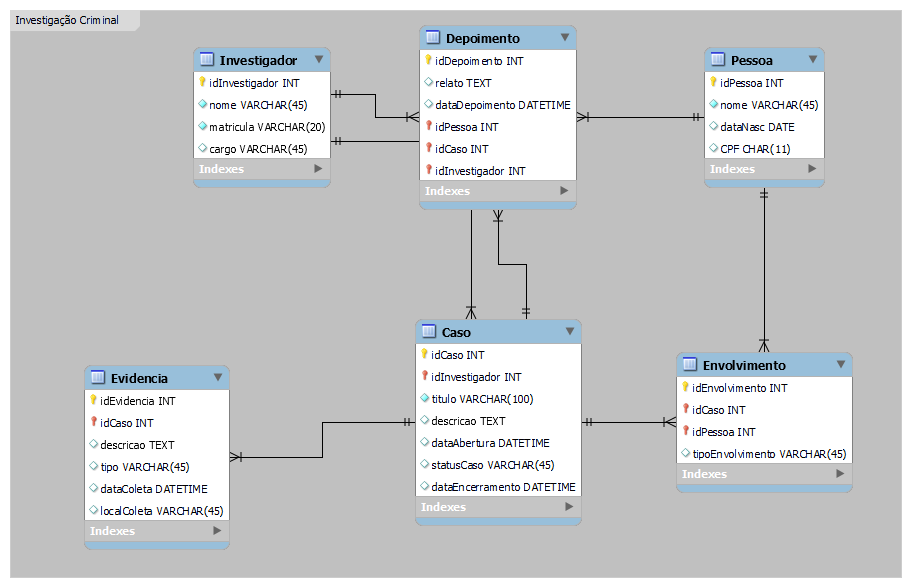

# 🔎 CaseFiles — Criminal Investigation Database

Sistema de banco de dados relacional destinado ao gerenciamento de investigações criminais, desenvolvido como projeto acadêmico da disciplina de Banco de Dados do curso de Bacharelado em Ciência da Computação do IFSULDEMINAS — Campus Muzambinho.

## 🎯 Objetivo

Organizar e gerenciar informações relacionadas a investigações criminais, permitindo o armazenamento de casos, investigadores, pessoas envolvidas, evidências e depoimentos.

## 🚀 Tecnologias utilizadas

- MySQL
- MySQL Workbench
- SQL
- Modelagem Entidade-Relacionamento (MER)
- DDL e DML

## 📋 Funcionalidades

- Cadastro de investigadores;
- Cadastro de pessoas;
- Gerenciamento de casos criminais;
- Controle da situação das investigações;
- Registro de evidências;
- Registro de depoimentos;
- Identificação do envolvimento de pessoas nos casos;
- Consultas e filtragem de registros.

## 🗃️ Estrutura do banco de dados

O banco de dados é composto por seis entidades principais:

| Entidade | Descrição |
|---|---|
| Pessoa | Armazena os dados das pessoas cadastradas. |
| Investigador | Armazena os dados dos investigadores. |
| Caso | Gerencia as investigações criminais. |
| Evidencia | Registra as evidências coletadas. |
| Envolvimento | Relaciona pessoas aos casos. |
| Depoimento | Armazena os relatos registrados. |

## 📊 Diagrama Entidade-Relacionamento

## ⚙️ Como executar

1. Clone ou baixe este repositório.
2. Abra o MySQL Workbench.
3. Conecte-se ao servidor MySQL.
4. Abra o arquivo `casefiles.sql`.
5. Execute o script para criar e popular o banco de dados.
6. Utilize as consultas SQL disponíveis no arquivo.

## 📚 Conceitos aplicados

- Modelagem relacional;
- Chaves primárias e estrangeiras;
- Relacionamentos 1:N e N:M;
- Integridade referencial;
- Restrições UNIQUE e NOT NULL;
- Comandos CREATE, INSERT, SELECT e WHERE.

## 🎓 Contexto acadêmico

- Instituição: IFSULDEMINAS — Campus Muzambinho
- Curso: Bacharelado em Ciência da Computação
- Disciplina: Banco de Dados
- Ano: 2026

## ⚠️ Observação

Todos os registros utilizados neste projeto são fictícios e possuem finalidade exclusivamente acadêmica.
